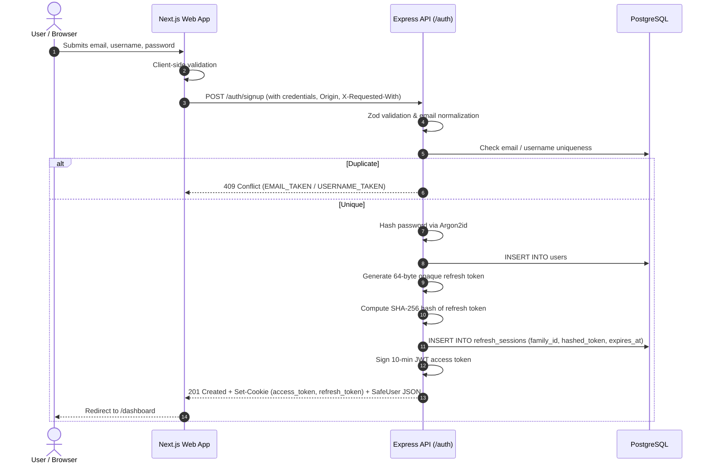
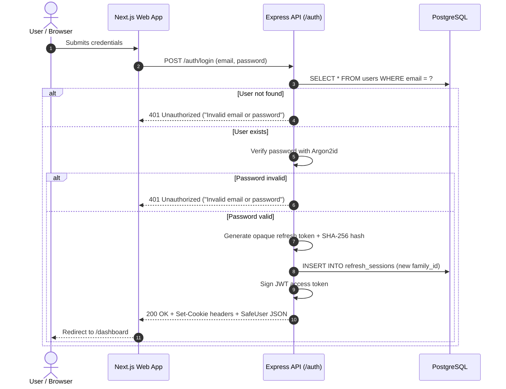

# Streamline — Authentication Architecture (Milestone 2)

## 1. Overview & Goals

Streamline uses a hybrid authentication model designed for security, auditability, and clear separation of concerns:

- **Access Tokens:** Short-lived (10-minute) JSON Web Tokens (JWT) signed with HMAC-SHA256 (`HS256`).
- **Refresh Tokens:** Long-lived (30-day), cryptographically random 64-byte opaque strings stored only as SHA-256 hashes in PostgreSQL.
- **Client Transport:** `HttpOnly`, `SameSite=Lax`, `Secure` (in production) cookies, keeping sensitive token strings inaccessible to browser JavaScript.
- **CSRF Defense:** Defense-in-depth verifying `Origin`/`Referer` headers and enforcing custom `X-Requested-With` headers on cookie-authenticated mutations.
- **Reuse Detection:** Immediate family-wide session termination upon reuse of an already-rotated refresh token.

---

## 2. Authentication Flows

### Signup Flow (`POST /auth/signup`)



### Login Flow (`POST /auth/login`)



---

## 3. JWT Architecture: Anatomy & Claims

A JSON Web Token consists of three base64url-encoded parts separated by periods (`.`): `header.payload.signature`.

### Header

```json
{
  "alg": "HS256",
  "typ": "JWT"
}
```

Streamline strictly enforces an explicit algorithm allowlist (`HS256`). Tokens specifying `alg: "none"` or asymmetrical algorithms like `RS256` when expecting symmetric keys are immediately rejected.

### Payload

```json
{
  "sub": "5916c721-2183-4817-9e26-15a39e51599c",
  "email": "creator@streamline.live",
  "username": "creator",
  "tokenPurpose": "access",
  "jti": "fd7ed65a-cf90-4f78-8d00-25f7b4541f71",
  "iss": "streamline",
  "aud": "streamline-app",
  "iat": 1792590053,
  "exp": 1792590653
}
```

- **`sub` (Subject):** The user's immutable UUID.
- **`iss` (Issuer):** Configured application identifier (`streamline`), validated on every request.
- **`aud` (Audience):** Intended recipient (`streamline-app`), validated on every request.
- **`iat` (Issued At):** Epoch timestamp marking issuance.
- **`exp` (Expiration):** Epoch timestamp after which the token is invalid (10 minutes).
- **`jti` (JWT ID):** Cryptographic UUID uniquely identifying each issued token.
- **`tokenPurpose`:** Explicit claim set to `"access"` to prevent token confusion attacks.

### Signature

The signature is generated using HMAC-SHA256 over `base64url(header) + "." + base64url(payload)` using a high-entropy secret (`JWT_SECRET`, min 256 bits).

> **Decoding vs. Verifying:**
> Anyone can decode a JWT payload (`jwt.decode()` or `atob()`) because base64url is an encoding, not encryption.
> **Decoding provides zero authenticity or integrity guarantee.**
> Streamline **never** trusts claims from a decoded token without first cryptographically verifying the signature (`jwtVerify` with secret and strict claim expectations).

---

## 4. Opaque Refresh Tokens vs. JWT Refresh Tokens

Streamline deliberately uses **opaque refresh tokens** rather than self-contained JWT refresh tokens.

| Feature                  | JWT Refresh Token                         | Opaque Refresh Token (Streamline)           |
| :----------------------- | :---------------------------------------- | :------------------------------------------ |
| **Revocation Speed**     | Difficult without a centralized blocklist | Instantaneous database check                |
| **Server-Side State**    | Stateless (cannot easily detect theft)    | Stateful session record in PostgreSQL       |
| **Token Size**           | Large (~300–800 bytes)                    | Compact 64-byte random string               |
| **Reuse Detection**      | Requires tracking every JTI in Redis/DB   | Built-in via session lineage and `familyId` |
| **Leakage Blast Radius** | Compromised until expiration              | Revoked immediately upon reuse detection    |

### Why Store Hashes in PostgreSQL?

Just like passwords, raw refresh tokens are bearer credentials. If an attacker gains read access to the database (e.g., via SQL injection or leaked backup), storing raw refresh tokens would give them immediate access to impersonate every user.
Streamline generates 64 random bytes (`crypto.randomBytes(64).toString('hex')`), transmits the raw string once to the client in an `HttpOnly` cookie, and stores only its **SHA-256 hash** (`crypto.createHash('sha256').update(raw).digest('hex')`) in the database.

---

## 5. Token Rotation, Revocation & Reuse Detection

To protect against token theft, Streamline implements **Single-Use Refresh Token Rotation with Token Family Revocation**:

1. **Rotation on Use:** When the client calls `POST /auth/refresh`, the server locates the active session, sets `revokedAt = now()`, records `replacedBy = newHash`, and inserts a new session within the same `familyId`.
2. **Reuse Detection:** If an already-revoked refresh token is presented:
   - This indicates either an attacker intercepted the token, or a concurrent replay attack is taking place.
   - The server catches this condition (`session.revokedAt !== null`).
   - The server executes `UPDATE refresh_sessions SET revokedAt = now() WHERE familyId = ? AND revokedAt IS NULL`, terminating **all** active sessions in that lineage.
   - Both authentication cookies are cleared on the client.
   - A `401 Unauthorized` with error code `TOKEN_REUSE_DETECTED` is returned.

---

## 6. Authentication Middleware & Authorization

The `requireAuth` middleware protects endpoints by:

1. Extracting the JWT from the `access_token` HttpOnly cookie (or `Authorization: Bearer <token>` header).
2. Verifying the signature, expiration, issuer, audience, and `tokenPurpose === 'access'` using `jose`.
3. Verifying that the user still exists in the PostgreSQL database.
4. Attaching the safe user object (`id`, `email`, `username`, `createdAt`, `updatedAt`) to `req.user`.

```ts
// Distinct separation of concerns:
// Authentication: "Who are you?" (handled by requireAuth)
// Authorization: "Are you allowed to stream / edit this channel?" (handled in domain handlers)
```

---

## 7. Browser Security, Cookies & CSRF Defense

### Cookie Attributes

| Attribute    | Access Token Cookie  | Refresh Token Cookie | Rationale                                       |
| :----------- | :------------------- | :------------------- | :---------------------------------------------- |
| **Name**     | `access_token`       | `refresh_token`      | Distinct cookie identifiers                     |
| **Path**     | `/`                  | `/auth`              | Refresh token sent only to auth endpoints       |
| **HttpOnly** | `true`               | `true`               | Inaccessible to `document.cookie` / XSS scripts |
| **SameSite** | `Lax`                | `Lax`                | Mitigates cross-site request forgery            |
| **Secure**   | `true` in production | `true` in production | Transmitted only over HTTPS                     |
| **Max-Age**  | `600` (10 minutes)   | `2592000` (30 days)  | Matches token lifetime                          |

### Defense-in-Depth CSRF Mitigation

Because authentication cookies are automatically attached by browsers to cross-origin requests, Streamline enforces two layers of CSRF defense in `csrfProtection`:

1. **Strict Origin & Referer Validation:** State-changing requests (`POST`, `PUT`, `DELETE`, `PATCH`) must originate from the configured `FRONTEND_URL` (`http://localhost:3000`). Mismatches return `403 CSRF_ORIGIN_MISMATCH`.
2. **Custom Header Requirement (`X-Requested-With`):** Any state-changing request carrying auth cookies must include `X-Requested-With: XMLHttpRequest`. Standard HTML `<form action="...">` submissions cannot attach custom headers across origins without triggering a CORS preflight that is rejected by the API.

---

## 8. Development & Verification Guide

### Prerequisites

- Docker Compose running PostgreSQL on port `5433` and Redis on port `6379`.
- Node.js >= 20.

### Starting Local Services

```bash
# Terminal 1: Run PostgreSQL & Redis containers
docker compose up -d

# Terminal 2: Run Express API (port 4000)
pnpm --filter @streamline/api dev

# Terminal 3: Run Next.js Web App (port 3000)
pnpm --filter @streamline/web dev
```

### Running Tests & Quality Checks

```bash
# Run unit & integration test suites
pnpm test

# Run TypeScript typechecks across all 7 workspace packages
pnpm run typecheck

# Run ESLint across monorepo
pnpm run lint

# Check code formatting with Prettier
pnpm run format:check

# Run production build
pnpm run build
```

---

## 9. Known Limitations & Roadmap

Milestone 2 establishes a secure, robust foundation for authentication. The following items are explicitly deferred to future milestones:

- **Email Verification:** Account creation is active immediately; email verification tokens will be added alongside notification services.
- **Password Reset / Recovery:** Self-service password reset flows via email magic links.
- **Multi-Factor Authentication (MFA/TOTP):** Time-based one-time passwords for creator accounts.
- **Role-Based Access Control (RBAC):** Admin moderation roles and permission checks.
- **Distributed Rate Limiting:** In-memory sliding window is currently used for auth endpoints; Redis-backed rate limiting will be integrated as traffic scales.
